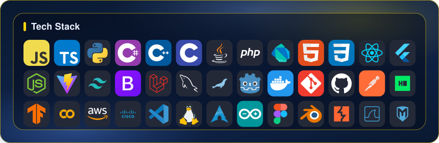
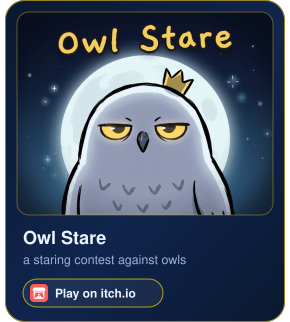
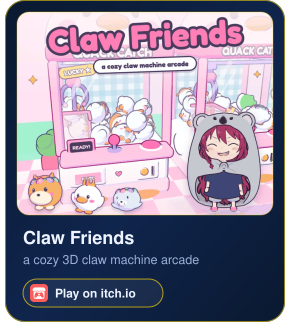
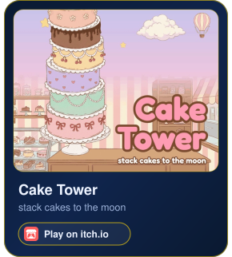
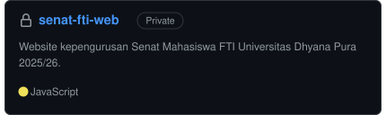
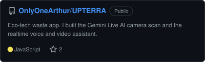
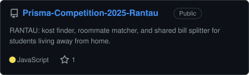
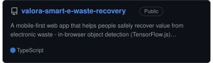

<!-- games:start -->

<!-- games:end -->

<picture>
  <source media="(prefers-color-scheme: dark)" srcset="https://raw.githubusercontent.com/GianneAngely/GianneAngely/output/pacman-contribution-graph-dark.svg">
  <source media="(prefers-color-scheme: light)" srcset="https://raw.githubusercontent.com/GianneAngely/GianneAngely/output/pacman-contribution-graph.svg">
  
</picture>

<!-- collab:start -->

<!-- collab:end -->

